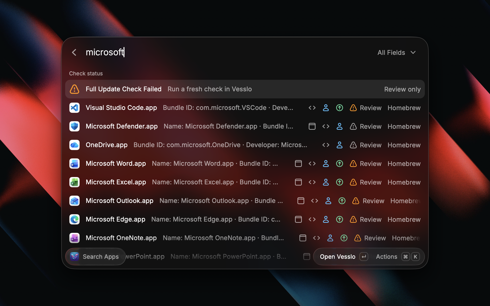
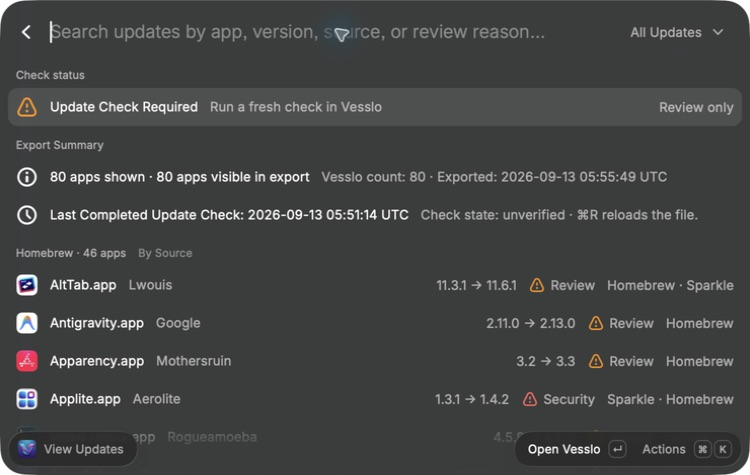
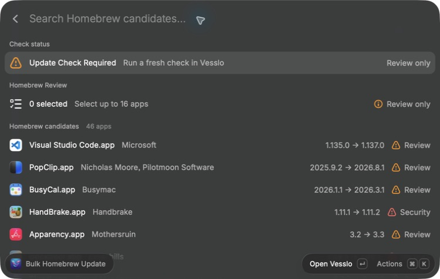
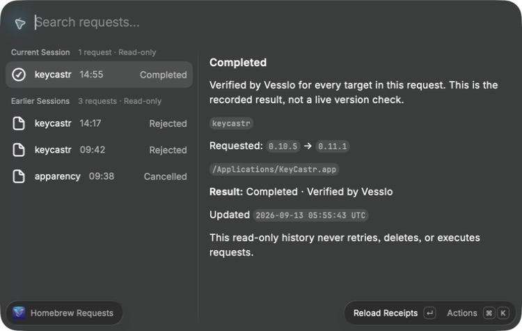

# Vesslo Raycast 익스텐션

## 앱 검색부터 업데이트 결과 확인까지, 키보드로 이어지는 앱 관리

앱 이름은 기억나지 않지만, 예전에 적어 둔 메모나 태그는 떠오를 때가 있습니다. 업데이트할 앱을 찾은 뒤에도 어느 버전으로 바뀌는지, 실제로 처리가 끝났는지 다시 확인해야 합니다.

Vesslo Raycast 익스텐션은 **Vesslo에 정리한 앱을 빠르게 찾고, 업데이트 후보를 살펴보고, 처리 결과까지 확인하는 창구**입니다. 앱 검색과 목록 탐색은 Raycast에서, 선택한 Homebrew 앱의 최종 확인과 업데이트는 Vesslo에서 이어집니다.

> **게시 준비 원고** · 아래 내용과 화면은 이번에 완성한 로컬 업데이트판 기준입니다. 현재 Store의 기존 배포판과 차이가 있으므로, 호환되는 Vesslo 본체와 익스텐션 업데이트가 공개된 뒤 소개 글로 사용해 주세요.

## 이번 업데이트에서 달라진 점

| 구분 | 달라진 기능 | 사용자가 얻는 것 |
| --- | --- | --- |
| 새 명령 | **Homebrew Requests** | 요청별 진행 상태와 앱별 처리 결과를 다시 확인합니다. |
| 새 명령 | **Review Apps · Deleted Apps** | 검토가 필요한 앱과 이미 삭제된 앱의 기록을 따로 찾습니다. |
| 검색 보강 | **Bundle ID 검색, 검색 필드 선택, 일치 문맥 표시** | 이름이 비슷한 앱을 구분하고 메모에 적어 둔 내용으로도 찾습니다. |
| 업데이트 흐름 변경 | **최대 16개를 선택해 Vesslo에서 확인 후 실행** | 선택한 앱과 버전을 살펴보고 업데이트를 승인합니다. |
| 화면 정리 | **간결한 목록과 작은 완료 제목** | 반복되는 큰 배지 대신 앱 이름·버전·결과를 먼저 읽습니다. |

기존 Store 소개에 있던 Homebrew·Terminal 직접 실행 중심의 설명도 바뀝니다. 이번 버전의 Homebrew 업데이트는 **선택한 대상을 Vesslo에 전달하고 확인받는 흐름**을 사용합니다.

## 1. 이름이 기억나지 않아도 앱을 찾으세요

**Search Apps**에서는 앱 이름뿐 아니라 개발자, Bundle ID, 태그, 메모를 검색할 수 있습니다. 전체 항목을 함께 검색하거나, 찾고 싶은 필드만 골라 범위를 좁히세요. 메모가 검색어와 일치하면 관련 문맥도 확인할 수 있습니다.

예를 들어 개발자 이름으로 그 회사의 앱을 찾거나, Vesslo에서 붙여 둔 태그로 작업용 앱을 모아 볼 수 있습니다. 검색 결과에서 앱을 열고, Finder에서 위치를 확인하거나, Vesslo의 해당 앱 화면으로 이동하는 동작도 이어집니다.

*앱 이름 옆에 버전과 개발자를 배치하고, 업데이트 소스는 간결한 텍스트로 보여 줍니다. 이 예시는 업데이트 검사 갱신이 필요한 상태이며, 목록 검색은 계속 사용할 수 있습니다.*

## 2. 업데이트할 앱과 바뀔 버전을 먼저 확인하세요

**View Updates**는 Vesslo가 확인한 업데이트 후보를 모아 보여 줍니다. 현재 버전과 업데이트 대상 버전을 나란히 보고, Homebrew·Sparkle·App Store·수동 설치·검토 필요 항목으로 필터링할 수 있습니다.

목록 위에서는 마지막으로 완료된 검사 시각과 현재 데이터 상태를 확인할 수 있습니다. 필요한 경우 `⌘I`로 상세 정보를 펼쳐 앱 경로, Bundle ID, 업데이트 소스와 검토 사유를 살펴보세요.

*버전의 변화가 목록 안에 바로 표시됩니다. 촬영 당시의 앱 개수와 버전은 예시이며, 사용자의 Vesslo 목록에 따라 달라집니다.*

## 3. Homebrew 앱은 선택하고, 확인한 뒤 업데이트하세요

**Bulk Homebrew Update**에서는 업데이트 가능한 Homebrew 앱을 **한 번에 최대 16개** 선택할 수 있습니다. 검색어를 바꿔도 선택한 앱은 유지되므로, 필요한 앱을 차례로 모을 수 있습니다.

사용 흐름은 다음과 같습니다.

1. Raycast에서 Homebrew 업데이트 후보를 찾습니다.
2. 업데이트할 앱을 선택하고 선택 목록을 살펴봅니다.
3. Vesslo로 이동해 앱과 버전을 확인합니다.
4. Vesslo에서 명시적으로 승인하면 업데이트가 시작됩니다.
5. 요청 결과는 **Homebrew Requests**에서 다시 확인합니다.

전달 직전에도 앱의 설치 위치와 버전, 업데이트 대상이 같은지 확인합니다. 검사 결과가 오래되면 Vesslo에서 새 검사를 진행하고, 대상 정보가 바뀌면 데이터를 다시 읽은 뒤 대상을 다시 선택하도록 안내합니다. 한 앱만 업데이트할 때도 같은 검토 흐름을 사용합니다.

*이 화면은 검사 갱신이 필요한 `Review only` 상태의 예시입니다. 최신 검사 결과로 대상이 확인되면 선택·검토를 진행할 수 있습니다. 목록에 보이는 모든 앱이 곧바로 실행 가능한 것은 아닙니다.*

## 4. 요청이 끝났는지, 앱별 결과로 확인하세요

업데이트 요청을 보냈다는 사실과 업데이트가 완료됐다는 사실은 다릅니다. 새 **Homebrew Requests** 명령은 Vesslo가 기록한 요청 상태와 원래 선택한 앱별 결과를 보여 줍니다.

검토 대기, 실행 중, 검증 대기, 완료, 실패, 거절, 취소를 구분하며, 완료 화면에서는 **Homebrew에 등록된 이름·요청한 버전 변화·설치 경로·결과**를 먼저 확인할 수 있습니다. 긴 요청 번호와 진단 정보는 **View Technical Details**에서 필요할 때 펼쳐 봅니다.

*실제 KeyCastr `0.10.5 → 0.11.1` 업데이트 요청의 완료 기록입니다. `Completed`는 해당 요청의 모든 대상에 대해 Vesslo가 검증을 마쳤다는 뜻이며, 지금 설치된 버전을 새로 검사한 결과는 아닙니다.*

기록을 조회하는 화면이므로 실수로 같은 요청을 다시 실행하지 않습니다. 과거 실행 세션의 결과와 취소·거절 기록도 구분해서 볼 수 있습니다.

## 일곱 가지 명령, 이렇게 사용하세요

| Raycast 명령 | 이런 때 사용하세요 |
| --- | --- |
| **Search Apps** | 앱 이름, 개발자, Bundle ID, 태그나 메모로 앱을 찾을 때 |
| **View Updates** | 업데이트 후보와 버전 변화, 소스를 살펴볼 때 |
| **Bulk Homebrew Update** | 여러 Homebrew 앱을 선택해 Vesslo에서 확인 후 업데이트할 때 |
| **Browse by Tag** | Vesslo에 붙여 둔 태그별로 설치 앱을 모아 볼 때 |
| **Review Apps** | Vesslo가 표시한 보안·업데이트 소스·관리 관련 검토 사유를 확인할 때 |
| **Deleted Apps** | 삭제한 앱의 이름이나 남겨 둔 메모·태그를 다시 찾을 때 |
| **Homebrew Requests** | 업데이트 요청의 진행 상태와 앱별 결과를 확인할 때 |

**Review Apps**는 Vesslo가 내보낸 검토 내용을 읽는 화면입니다. 확장에서 새 보안 검사를 실행하지는 않습니다. **Deleted Apps** 역시 남아 있는 기록을 검색하는 기능이며, 앱을 복원하거나 재설치하는 기능은 아닙니다. 메모와 태그의 작성·수정은 Vesslo에서 진행합니다.

## 시작하는 방법

1. Mac에 **Vesslo와 Raycast**를 설치합니다. Vesslo 본체의 이용 조건은 [공식 제품 페이지](https://vesslo.top/vesslo)에서 확인할 수 있습니다.
2. Vesslo를 실행해 앱 목록을 준비하고 업데이트 검사를 진행합니다. Vesslo가 Raycast에서 읽을 로컬 데이터를 자동으로 만듭니다.
3. 호환되는 업데이트판이 공개되면 [Vesslo Store 페이지](https://www.raycast.com/hjm79/vesslo)에서 익스텐션을 설치한 뒤, Raycast에서 Vesslo 명령을 검색해 실행합니다.
4. Vesslo에서 목록을 바꿨다면 **Reload Vesslo Data (`⌘R`)**로 다시 읽습니다.

최신 Homebrew 검토·요청 결과 기능에는 해당 연동을 지원하는 Vesslo 본체가 필요합니다. 구버전 데이터나 확인할 수 없는 상태에서는 조회만 가능하거나 Vesslo에서 검사를 다시 진행하라는 안내가 나올 수 있습니다.

## 사용 전에 알아두면 좋은 점

**`⌘R`은 새 업데이트 검사가 아닙니다.** Vesslo가 저장한 목록을 다시 읽는 동작입니다. 최신 업데이트 여부를 확인하려면 Vesslo에서 검사를 진행하세요.

**`Review only`는 현재 자료를 살펴볼 수 있다는 뜻입니다.** 검사 결과가 오래됐거나 정보가 맞지 않으면 실행을 제한합니다. `Verification Pending`도 완료가 아니라 추가 확인을 기다리는 상태입니다.

**앱 정보는 Vesslo의 로컬 데이터를 바탕으로 표시합니다.** 확장에 별도의 계정이나 API 키를 입력할 필요는 없습니다. 업데이트를 요청하면 선택한 앱 정보가 같은 Mac의 Vesslo로 전달됩니다. 실제 업데이트 다운로드나 App Store 동작은 Vesslo와 해당 서비스에서 이어집니다.

## 찾는 데서 끝나지 않는 앱 관리

Vesslo에 쌓아 둔 메모와 태그로 앱을 찾고, 바뀔 버전을 살펴보고, 확인한 대상만 업데이트한 뒤 결과까지 확인하세요. Vesslo Raycast 익스텐션은 이 흐름을 일곱 가지 명령으로 연결합니다.

---

*화면 안내: Search Apps는 사용자가 2026년 9월 26일 촬영한 2000×1250 PNG이며, 나머지 세 장은 2026년 9월 13일 실제 Raycast에서 촬영한 화면입니다. 이미지를 합성하거나 상태·버전·문구를 변경하지 않았습니다. 소개용 원본 이미지이며 Store 제출용 이미지 규격 검사는 별도로 진행해야 합니다.*
